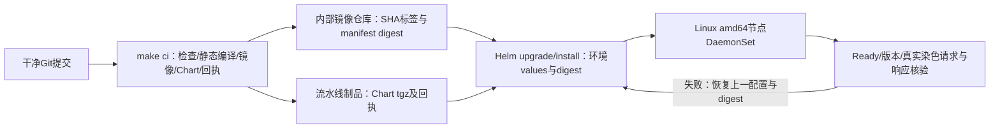

# 内部测试环境构建与部署

用同一套命令接入 Jenkins、GitLab CI 或其他流水线；CI产出固定源码制品，CD用环境配置部署已有Istio Ambient节点。



|项目|当前行为|
|---|---|
|构建入口|根目录`make ci`，非Java Demo构建脚本；失败返回非零，保留失败回执|
|Runner依赖|Git、Go 1.27.x（go.mod要求）、Make、Docker daemon、Helm 3；在内部固定工具版本|
|依赖下载|Go模块首次构建需要网络或内网GOPROXY；镜像FROM scratch，无基础镜像下载|
|Dockerfile|仅打包预先CGO_ENABLED=0编译的Linux二进制；不支持单独一次docker build完成源码编译，使用make入口|
|架构|默认image amd64，与常驻DaemonSet匹配；构建arm64二进制不代表arm64探针已验收|
|版本|镜像`<repository>:<完整GitSHA>-amd64`；Chart 0.2.0，appVersion静态0.1.0不替代实际SHA；回执绑定源码与制品hash|
|推送|`make push`显式推送；`make ci`不访问仓库凭据、不自动部署|
|Chart模式|默认安全回放；内部部署必须显式daemon.enabled=true、syntheticReplay=false、capture=false|
|环境参数|仓库/tag/digest、已有imagePullSecrets、namespace白名单、标签、方向、染色头、节点标签/tolerations/priority/resources|
|权限|hostPID、root、BPF/PERFMON/SYS_PTRACE、只读BTF/tracefs、seccomp Unconfined；无privileged/SYS_ADMIN/NET_ADMIN|
|RBAC|集群pods只读get/list/watch；namespace过滤是采集范围，不是RBAC隔离|
|Job模式限制|回放/有限capture使用固定Job名；已存在Job的镜像/args升级可能被K8s不可变字段拒绝。重复实验用独立release名或明确清理旧Job；常驻CD使用DaemonSet|
|升级|同节点不surge，maxUnavailable=1；元数据或进程变化按原逻辑重新发现，升级期间有采集空窗|
|失败|Ready失败可由Helm回退；采集保护NotReady后需排障，未配置liveness强制重启绕过保护|

## CI：构建与推送

在干净检出目录执行。不要把部署配置、下载目录或凭据写成未忽略文件后再构建，否则固定SHA镜像门禁会拒绝。每次CI使用独立工作目录；锁不自动抢占，失败后确认无运行进程再清理。

```sh
set -eu
export CGO_ENABLED=0
export IMAGE_REPOSITORY=registry.example.com/observability/ztunnel-ebpf-collector
export IMAGE_ARCH=amd64
REVISION=$(git rev-parse HEAD)
make ci
# 登录在CI凭据步骤完成，例如密码通过stdin提供；不放进Git/Dockerfile/values。
make push
# 将以下整个目录作为流水线制品归档：
# dist/$REVISION/ （含二进制、Chart tgz、build-receipt.json、registry-digests.txt）
```

`registry-digests.txt`保存Docker返回的`repository@sha256:...`引用。CD选择本仓库对应的digest；它是**仓库manifest digest**，不能使用`image-id.txt`的本机image ID代替。此推送入口需要已有docker login；本项目未配置真实内部仓库，未实测推送权限。

Go依赖可通过Runner的`GOPROXY`、`GONOSUMDB/GOPRIVATE`按内部规范配置；不要把令牌放进Docker构建参数。scratch无shell、curl、证书库；采集器的Kubernetes访问使用Pod挂载的CA/token，当前不依赖公共HTTPS根证书。

## CD：部署同一制品

从[values示例](../charts/ztunnel-ebpf-collector/values-internal-test.yaml)生成内部环境文件，修改仓库、namespaces、selector和染色规则。已有registry-auth位于采集器namespace；由内部Secret系统管理，不由Chart生成。

```sh
set -eu
: "${KUBECONFIG:?explicit internal test kubeconfig required}"
: "${IMAGE_REPOSITORY:?required}"
: "${REVISION:?CI source SHA required}"
: "${IMAGE_DIGEST:?sha256 registry manifest digest required}"
# artifacts目录来自CI归档，而不是另一份未固定源码的重新构建。
CHART=artifacts/ztunnel-ebpf-collector-0.2.0.tgz
helm lint "$CHART" -f values-internal.yaml
helm template collector "$CHART" -n ztunnel-sensor -f values-internal.yaml \
  --set-string image.repository="$IMAGE_REPOSITORY" \
  --set-string image.tag="$REVISION-amd64" --set-string image.digest="$IMAGE_DIGEST" > rendered.yaml
helm upgrade --install collector "$CHART" -n ztunnel-sensor --create-namespace \
  -f values-internal.yaml --set-string image.repository="$IMAGE_REPOSITORY" \
  --set-string image.tag="$REVISION-amd64" --set-string image.digest="$IMAGE_DIGEST" \
  --atomic --wait --timeout 5m --history-max 10
kubectl -n ztunnel-sensor rollout status daemonset/collector-node --timeout=120s
kubectl -n ztunnel-sensor get pods -o wide
kubectl -n ztunnel-sensor logs -l app.kubernetes.io/instance=collector-node --prefix --since=2m --tail=100
```

不同集群用独立KUBECONFIG及values；相同集群、namespace、release的发布必须串行，避免并行升级。保留上一可用Chart、values、digest与Helm revision。部署超时需检查保护日志及节点状态；不要只增加超时或CPU上限掩盖问题。安装成功后仍需在选中业务Pod发一条染色及一条非染色请求，确认真实新请求/响应与身份正确、非染色无误输出。Ready只证明加载/元数据状态，不证明业务端到端完整性。需要撤销发布时使用上一固定制品/values，或核对历史后执行`helm rollback collector PREVIOUS_REVISION -n ztunnel-sensor --wait --timeout 5m`。

## 内部节点前提与验收边界

|检查|要求|
|---|---|
|平台|Ubuntu24 amd64；核验内核BPF/BTF、tracefs及proc权限，组织准入允许上述权限|
|网格|已有可用Istio Ambient/ztunnel；采集器Chart不安装Istio或修改CNI；HOST_PROBE_SNAT_IP等环境适配属Istio CNI配置，按目标CNI独立核验|
|业务|目标已接入网格，匹配namespace白名单与标签；协议根据内容识别，不需要按端口设置HTTP/gRPC类型|
|加密|ztunnel网格mTLS路径适用；Dapr自身TLS或应用HTTPS、数据库TLS不能据此宣称解密支持|
|资源|requests/limits可配置，但内核/节点预算仍独立；本轮不调整已验证预算，不承诺内部高QPS容量|
|共存|同一节点不要部署多套重叠范围采集器；测试采集namespace保持不入网格|
|日志|业务结果只stdout；Kubernetes/公司日志代理是否落盘或集中保存由内部日志策略决定|

本轮验证：私有仓库/digest三模式渲染、非法digest拒绝、调度与资源参数、架构限制及原Chart回归；本机真实amd64镜像构建和整体CI结果见验证摘要。没有连接内部集群或内部仓库，**未验证真实私有仓库拉取、内部准入和内部业务采集**。模板验证不等于目标集群发布完成。
